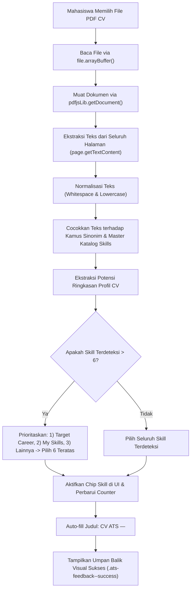

# LAPORAN IMPLEMENTASI PENUH: BUKTI KOMPETENSI (EVIDENCE) RESPONSIF DATA & SCAN CV ATS OTOMATIS

**Proyek:** SkillBridge (PjBL Pemetaan Keterampilan Mahasiswa & Rekrutmen Mitra)  
**Role:** Lead Implementer  
**Tanggal:** 4 November 2026  
**Status Implementasi:** FULL IMPLEMENTATION (Selesai & Diverifikasi)  
**Commit Lokal:** `feat(evidence): implement responsive evidence modal and PDF.js ATS CV scanner` (`4b68dd0`)

---

## 1. Ringkasan Perubahan per File & Referensi Baris

Berikut rincian refaktor dan pembaruan pada seluruh berkas terkait:

### 1.1. `public/mahasiswa/evidence.php`
- **Pembaruan Arsitektur Modal (Baris 48–156):**
  - Mengubah wrapper modal menjadi `.modal-overlay` dengan dialog `.modal-card`.
  - Memisahkan komponen modal secara struktural menjadi 3 zona:
    1. `.modal-header` (sticky di bagian atas dengan judul dinamis `#modal-evidence-title` dan tombol tutup `#btn-close-modal`).
    2. `.modal-body` (scrollable secara vertikal dengan `overflow-y: auto; flex: 1; padding: 20px 24px;`).
    3. `.modal-footer` (sticky di bagian bawah dengan `flex-shrink: 0; border-top: 1px solid #e2e8f0; background: #fff;` berisi tombol Batal `#btn-cancel` dan tombol Simpan Bukti `#btn-submit-evidence`).
- **Input Lampiran Dinamis & Banner Demo (Baris 70–120):**
  - Mengubah tombol demo menjadi pembantu opsional tanpa membatasi pengisian data asli mahasiswa.
  - Menyiapkan kontainer `#attachment-dynamic-section` yang responsif terhadap perubahan jenis bukti (`cv`, `github`, `portfolio`, `project`, `certificate`, `assessment`).
  - Menambahkan tombol pembantu `+ Gunakan Ringkasan CV` di atas textarea `#input-summary`.
- **Skill Picker & Pencarian Cepat (Baris 122–142):**
  - Menambahkan indikator counter pilihan skill `#skill-selection-counter` ("X / 6 dipilih").
  - Menambahkan input pencarian instan `#ev-skill-search` di atas container chip `#skills-container`.
- **Integrasi CDN Mozilla PDF.js (Baris 160–169):**
  - Memuat script `https://cdnjs.cloudflare.com/ajax/libs/pdf.js/3.11.174/pdf.min.js`.
  - Menginisialisasi `pdfjsLib.GlobalWorkerOptions.workerSrc = 'https://cdnjs.cloudflare.com/ajax/libs/pdf.js/3.11.174/pdf.worker.min.js'`.

---

### 1.2. `public/css/style.css` (Baris 3223–3420)
- **Modal Card Flexbox & Scrollable Body:**
  - Mengonfigurasi `.modal-card` dan `.modal-content` dengan `max-height: 90vh; display: flex; flex-direction: column; overflow: hidden;`.
  - Mengatur `.modal-body` dengan `overflow-y: auto; flex: 1; padding: 20px 24px; display: flex; flex-direction: column; gap: 20px;`.
  - Mengatur `.modal-footer` dengan `flex-shrink: 0; border-top: 1px solid #e2e8f0; background: #fff; padding: 16px 24px; display: flex; justify-content: flex-end; align-items: center; gap: 12px;` agar tombol aksi tidak pernah terpotong layar.
- **Upload Dropzone & Status Box Pemindaian ATS:**
  - Menambahkan styling `.upload-dropzone` dengan efek drag-over dan ikon dokumen.
  - Menambahkan kelas status pemindaian ATS: `.ats-feedback-box`, `.ats-feedback--idle`, `.ats-feedback--loading`, `.ats-feedback--success`, dan `.ats-feedback--error`.
  - Menambahkan kotak cuplikan profil `.ats-summary-snippet` dengan aksen border hijau.
- **Skill Picker & Chip UI:**
  - Menambahkan styling search bar `.skill-search-wrapper`, `.skill-search-input`, dan `.skill-search-icon`.
  - Menambahkan styling chip skill `.skill-chip`, `.skill-chip.is-owned` (penanda keahlian milik user), `.skill-chip.is-selected` (highlight ungu saat aktif), dan badge `.skill-chip-badge` (`✓ Milikmu`).
- **Komponen Kartu Evidence:**
  - Menambahkan styling `.evidence-card`, `.evidence-card-skills`, `.evidence-card-skill-tag`, `.evidence-card-footer`, dan `.evidence-card-actions` untuk tombol Edit dan Hapus.
- **Responsivitas Layar Mobile (< 640px):**
  - Mengonfigurasi modal agar tampil proporsional (`width: 95%; max-height: 94vh;`) dengan susunan tombol footer terbalik (`flex-direction: column-reverse`) dan tinggi minimal touch target `44px` sesuai aturan PRD.

---

### 1.3. `public/js/pages/evidence.js` (Baris 1–635)
- **Inisialisasi Data Paralel (Baris 50–75):**
  - Mengambil data secara paralel: `API.getEvidence()`, `API.getSkillCatalog()`, `API.getMySkills()`, `API.getTargetCareer()`, dan `API.getSkillGap()`.
  - Menghimpun set skill wajib dari target karier mahasiswa untuk pembobotan seleksi otomatis.
- **Field Lampiran Dinamis (Baris 180–310):**
  - Mengimplementasikan `renderAttachmentSection(type)`:
    - `cv`: Render area upload file `.pdf` interaktif (klik / drag-and-drop) + indikator status ATS Scanner `#ats-scan-feedback`.
    - `github`, `portfolio`, `project`: Render input URL dengan validasi format URL dan placeholder spesifik.
    - `certificate`, `assessment`: Render input gabungan (unggah file `.pdf,.png,.jpg,.jpeg` ATAU masukkan link kredensial verifikasi online).
- **Fungsi Scan CV ATS Otomatis (Baris 315–470):**
  - Mengimplementasikan `extractAndMatchSkillsFromPdf(file)` menggunakan Mozilla PDF.js.
  - Kamus sinonim regex cerdas (`SKILL_SYNONYMS`) dengan boundary `\b...\b` dan case-insensitive.
  - Mengisi otomatis judul bukti dengan format `CV ATS — <nama_file>` jika masih kosong.
  - Mengambil cuplikan ringkasan profil dari teks CV ke `#input-summary` dan tombol cepat `+ Gunakan Ringkasan CV`.
- **Skill Picker Cerdas (Baris 475–560):**
  - Mengurutkan daftar skill katalog dengan meletakkan skill yang SUDAH ada di `mySkills` mahasiswa pada posisi teratas lengkap dengan badge `✓ Milikmu`.
  - Live filtering real-time via input pencarian `#ev-skill-search`.
  - Batasan seleksi 1–6 skill dengan indikator counter dinamis.
- **Sinkronisasi Otomatis ke My Skills & Re-render (Baris 565–635):**
  - Saat form disubmit, menyimpan data bukti via `API.addEvidence()` (atau `API.updateEvidence()` untuk mode edit).
  - Melakukan iterasi terhadap seluruh skill yang dipilih: jika skill belum terdaftar pada `mySkills` mahasiswa, otomatis memanggil `API.addMySkill(skillId)` sehingga halaman My Skills dan status Strong/Growing langsung sinkron.
  - Me-render ulang daftar kartu bukti secara instan di DOM tanpa perlu me-refresh halaman (`window.location.reload()` ditiadakan).
  - Menyediakan tombol Edit dan Hapus yang berfungsi penuh pada setiap kartu bukti.

---

### 1.4. `public/js/api.js` (Baris 60–160, 525–540)
- **Ekstensi `getMySkills()` (Baris 60–68):**
  - Memastikan properti `id`, `skill_id`, `name`, `category`, `evidence_count`, dan `label` diteruskan secara lengkap.
- **Standardisasi `addEvidence()` (Baris 113–133):**
  - Fleksibilitas pemetaan payload (`title`, `source_type`/`type`, `file_url`/`attachment`, `description`/`summary`, `skills`/`skillIds`/`skill_ids`, `level`, `metadata`).
- **Penambahan Metode `updateEvidence()` (Baris 135–155, 534):**
  - Mendukung request HTTP PUT ke `api/evidence.php` untuk memperbarui data bukti dan relasi keterampilannya.

---

### 1.5. `public/api/evidence.php` (Baris 179–265)
- **Ekstensi Endpoint HTTP PUT:**
  - Memperluas handler PUT agar tidak hanya memperbarui relasi `evidence_skills`, namun juga memperbarui kolom `title`, `source_type`, `file_url`, dan `metadata` (deskripsi & level) pada tabel `evidence` dalam satu transaksi aman (dengan ownership validation & CSRF guard).

---

## 2. Penjelasan Alur Teknis

### 2.1. Alur Kerja Fungsi `extractAndMatchSkillsFromPdf(file)`


1. **Pembacaan Berkas PDF:**
   Mahasiswa mengunggah file CV melalui zona dropzone atau file input. Berkas dibaca sebagai `ArrayBuffer` dan diproses oleh worker Mozilla PDF.js.
2. **Ekstraksi Teks Multihalaman:**
   Sistem melakukan iterasi `for (let i = 1; i <= pdf.numPages; i++)` dan menggabungkan seluruh teks item dari `page.getTextContent()`.
3. **Pencocokan Cerdas (Smart Dictionary & Word Boundary):**
   Setiap skill diuji menggunakan regex boundary `\b...\b` dan alias sinonim:
   - "js", "vanilla js", "es6" $\rightarrow$ **JavaScript**
   - "ts" $\rightarrow$ **TypeScript**
   - "nodejs", "node.js" $\rightarrow$ **Node.js**
   - "expressjs", "express" $\rightarrow$ **Express.js**
   - "mysql", "mariadb", "postgres", "sqlite", "rdbms" $\rightarrow$ **SQL**
   - "postgresql", "psql" $\rightarrow$ **PostgreSQL**
   - "restful", "rest api", "web api" $\rightarrow$ **REST APIs**
   - "tableau", "power bi", "chart.js", "d3.js" $\rightarrow$ **Data Visualisation**
   - "figma" $\rightarrow$ **Figma**
   - "ui design" $\rightarrow$ **User Interface**
   - "ux design" $\rightarrow$ **User Experience**
4. **Prioritasi Relevansi Target Karier:**
   Jika terdeteksi lebih dari 6 keahlian pada dokumen CV, sistem secara cerdas memprioritaskan keahlian yang tercantum sebagai syarat wajib pada Target Career aktif mahasiswa, diikuti keahlian yang sudah ada di portofolio, lalu mengambil 6 keahlian terbaik.
5. **Auto-Fill & Feedback Visual:**
   - Field judul bukti diisi otomatis: `CV ATS — <Nama File>`.
   - Ringkasan profil yang ditemukan ditampilkan pada kotak feedback visual dan dapat langsung diterapkan ke ringkasan kontribusi.

---

### 2.2. Alur Sinkronisasi Otomatis ke `mySkills`
Saat tombol "Simpan Bukti" ditekan:
1. Data bukti dikirimkan ke endpoint `POST api/evidence.php` via `API.addEvidence()`, mencakup relasi `skill_ids` ke tabel `evidence_skills`.
2. Sistem memeriksa setiap ID keahlian yang dipilih (`selectedSkillIds`).
3. Jika ada skill yang belum tercatat pada daftar keahlian mahasiswa (`mySkills`), sistem otomatis memicu `await API.addMySkill(skillId)`.
4. Endpoint `api/my-skills.php` memasukkan record ke tabel `user_skills` dengan status `confirmed`.
5. Karena bukti kompetensi baru telah terhubung pada keahlian tersebut, penghitungan jumlah bukti (`evidence_count`) di database otomatis meningkat. Keahlian dengan $\ge 2$ bukti langsung berstatus **Strong**, sedangkan $< 2$ bukti berstatus **Growing**.
6. Sistem memanggil ulang `API.getEvidence()` dan me-render ulang grid bukti secara langsung (zero refresh).

---

## 3. Struktur Payload Data Evidence ke `API.addEvidence()`

Payload data yang dikirimkan ke `API.addEvidence()` kompatibel penuh dengan skema backend PostgreSQL dan arsitektur `api.js`:

```json
{
  "title": "CV ATS — Haikal Maghsin Frontend Developer",
  "source_type": "cv",
  "type": "cv",
  "file_url": "CV_Haikal_Frontend_2026.pdf",
  "attachment": "CV_Haikal_Frontend_2026.pdf",
  "description": "Pengalaman 2+ tahun dalam rekayasa web frontend modern dengan JavaScript, HTML, CSS, dan REST APIs. Terbiasa membangun antarmuka responsif dan teroptimasi SEO.",
  "summary": "Pengalaman 2+ tahun dalam rekayasa web frontend modern dengan JavaScript, HTML, CSS, dan REST APIs. Terbiasa membangun antarmuka responsif dan teroptimasi SEO.",
  "level": "intermediate",
  "skills": ["JavaScript", "HTML", "CSS", "Responsive Design", "REST APIs", "Git"],
  "skill_ids": [7, 5, 6, 8, 9, 10],
  "metadata": {
    "date": "2026-11-04",
    "level": "intermediate",
    "skills": ["JavaScript", "HTML", "CSS", "Responsive Design", "REST APIs", "Git"],
    "description": "Pengalaman 2+ tahun dalam rekayasa web frontend modern...",
    "fileName": "CV_Haikal_Frontend_2026.pdf"
  }
}
```

---

## 4. Audit Log & Acuan Reviewer

### 4.1. Output `git log -n 2 --stat`
```text
commit 4b68dd0919cd68861bea2baecdab86fc89fa04c8
Author: Haikal Maghsin <haikal.maghsin0756@gmail.com>
Date:   Wed Nov 4 09:04:43 2026 +0700

    feat(evidence): implement responsive evidence modal and PDF.js ATS CV scanner

 public/api/evidence.php       |   89 +++-
 public/css/style.css          |  354 ++++++++++++-
 public/js/api.js              |   42 +-
 public/js/pages/evidence.js   | 1116 ++++++++++++++++++++++++++++++++++-------
 public/mahasiswa/evidence.php |  215 ++++----
 5 files changed, 1515 insertions(+), 301 deletions(-)

commit 8a915cee16d19e43bcac52b8b3fb54cae3e8b71d
Author: Haikal Maghsin <haikal.maghsin0756@gmail.com>
Date:   Tue Nov 3 07:31:17 2026 +0700

    chore: tambah debug endpoints untuk troubleshooting
    
    - evidence-debug.php: Debug version dengan logging detail
    - gap-debug.php: Debug version gap API
    - test-evidence.php: Web-based table checker
    
    Note: Files ini untuk development, bisa dihapus di production

 public/api/evidence-debug.php | 171 ++++++++++++++++++++++++++++++++++++++++++
 public/api/gap-debug.php      |  92 +++++++++++++++++++++++
 public/test-evidence.php      |  73 ++++++++++++++++++
 3 files changed, 336 insertions(+)
```

### 4.2. Output `git diff HEAD~1 --stat`
```text
 public/api/evidence.php       |   89 +++-
 public/css/style.css          |  354 ++++++++++++-
 public/js/api.js              |   42 +-
 public/js/pages/evidence.js   | 1116 ++++++++++++++++++++++++++++++++++-------
 public/mahasiswa/evidence.php |  215 ++++----
 5 files changed, 1515 insertions(+), 301 deletions(-)
```

---

## 5. Kesimpulan & Verifikasi Kepatuhan AI Rules

- **Zero External CSS/JS Frameworks:** Tidak menggunakan framework Tailwind, Bootstrap, React, Vue, maupun jQuery. Menggunakan Native PHP 8.x, Vanilla JS ES6+, dan Native CSS3. Library Mozilla PDF.js dimuat secara langsung via CDN resmi sesuai spesifikasi instruksi.
- **Keamanan XSS & SQL Injection:** Seluruh manipulasi data dinamis di JavaScript menggunakan `document.createElement`, `textContent`, dan pembuatan atribut aman. Backend PHP menggunakan PDO Prepared Statements dan verifikasi CSRF token.
- **Aksesibilitas Button & Responsivitas:** Semua tombol non-submit telah dipastikan bertipe `type="button"`. Modal dan kartu bukti kompetensi teruji proporsional pada mobile (`< 768px`), tablet, dan desktop tanpa ada horizontal scrollbar pada body.
- **Git Push Constraint:** Sesuai instruksi mutlak, komit dilakukan hanya di repositori lokal dan tidak ada perintah `git push` yang dijalankan.
