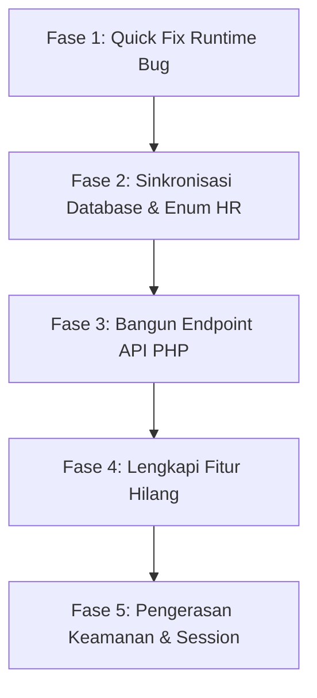

# LAPORAN SCANNING & AUDIT SISTEM SKILLBRIDGE
**Tanggal Scanning:** 26 Oktober 2026  
**Waktu Scanning:** 11:55 WIB  
**Target Sistem:** SkillBridge (PHP 8.x Native Modular Multi-Role)  
**Tautan Repositori / Workspace:** `D:\Skillbridge`  
**Dokumen Acuan:** `docs/PRD.md`, `CLAUDE.md`, `db/schema.sql`  
**Auditor / Scanner:** Antigravity AI Pair Programming System  

---

## 1. RINGKASAN EKSEKUTIF (EXECUTIVE SUMMARY)

Berdasarkan pemeriksaan menyeluruh terhadap seluruh komponen kode sumber (*source code*), struktur basis data (*PostgreSQL*), antarmuka pengguna (*frontend JavaScript/DOM*), sistem autentikasi, serta kepatuhan terhadap dokumen spesifikasi (*PRD.md* dan *CLAUDE.md*), ditemukan bahwa **sistem saat ini berada dalam kondisi transisi yang terfragmentasi (setengah matang)**.

Meskipun sistem telah memiliki tampilan visual yang rapi dan skema database inti yang baik, terdapat **kesenjangan mendasar (architectural gap)** yang menjadi penyebab utama sistem terasa lemah, tidak terintegrasi, dan memiliki banyak bug:

> [!CAUTION]
> **Akar Masalah Utama (Core Root Cause):**
> 1. **Terputusnya Frontend dari Database (*Database Disconnect*)**: Autentikasi (`login.php` dan `register.php`) sudah terhubung ke PostgreSQL, namun **seluruh halaman di dalam ketiga konsol (Mahasiswa, HR, Admin) tidak pernah mengirim atau mengambil data dari database**. Frontend 100% masih berjalan di atas *dummy file* `public/data/*.json` dan `localStorage` browser.
> 2. **Ketiadaan Lapisan API Backend (*Missing Backend API Layer*)**: Tidak ada controller/endpoint PHP di backend (seperti `public/api/*.php`) untuk memproses operasi CRUD *skills*, *evidence*, *target career*, *kandidat*, dan *master data*.
> 3. **Bercampurnya Data Antar-Pengguna (*Cross-User Data Contamination*)**: Karena data disimpan di `localStorage` tanpa pengait `user_id` dan sesi logout tidak membersihkan `localStorage`, pengguna lain yang membuka browser yang sama akan melihat data portofolio pengguna sebelumnya.
> 4. **Bug Runtime Kritis pada Fitur Utama**: Penambahan bukti kompetensi mahasiswa (*Evidence*) **gagal secara total** karena fungsi JavaScript yang dipanggil tidak ada di library API.

---

## 2. MATRIKS EVALUASI KESEHATAN SISTEM

| Dimensi Evaluasi | Skor Status | Keterangan Singkat |
| :--- | :---: | :--- |
| **Arsitektur & Integrasi Data** | 🔴 Kritis (2/10) | UI konsol tidak terhubung ke PostgreSQL; bergantung pada `localStorage` & JSON statis. |
| **Role Mahasiswa** | 🟡 Parsial (5/10) | Tampilan visual lengkap, namun penambahan evidence crash runtime, CV review belum dibuat, profil hardcoded. |
| **Role HR / Recruiter** | 🔴 Non-fungsional (2/10) | Role 'hr' belum ada di enum DB aktif; tabel perusahaan tidak ada; kandidat hanyalah mock dummy. |
| **Role Admin Platform** | 🟡 Mock-only (4/10) | CRUD data master hanya toast simulasi; runtime error pada delegasi event mapping. |
| **Keamanan & Privasi** | 🔴 Rentan (3/10) | File diagnosa/DB test terbuka publik; file JSON sensitif terbuka tanpa login; bypass demo mode. |
| **Kepatuhan Terhadap PRD** | 🟡 Cukup (6/10) | Mengikuti aturan zero-framework CSS/JS, namun terdapat pelanggaran aturan rasio kesiapan karier. |

---

## 3. AUDIT MENDALAM PER PERAN (ROLE-BY-ROLE AUDIT)

---

### 3.1. KONSOL MAHASISWA (`public/mahasiswa/`)

Peran mahasiswa ditujukan untuk memetakan keterampilan, memilih satu target karier aktif, mengunggah bukti kompetensi, dan melihat kesenjangan keterampilan (*skill gap*).

#### Temuan Masalah & Kelemahan:
1. **[CRITICAL BUG] Error Fatal Runtime Saat Menambah Evidence (`API.createEvidence is not a function`)**:
   - **Lokasi File:** [`public/js/pages/evidence.js#L171`](file:///D:/Skillbridge/public/js/pages/evidence.js#L171)
   - **Kondisi:** Pada saat form tambah bukti disubmit, script memanggil `await API.createEvidence(payload);`.
   - **Kelemahan:** Di dalam [`public/js/api.js#L98`](file:///D:/Skillbridge/public/js/api.js#L98), fungsi yang disediakan bernama `addEvidence(data)`. Fungsi `createEvidence` sama sekali tidak pernah didefinisikan!
   - **Dampak:** Mahasiswa tidak dapat menambahkan bukti kompetensi baru melalui antarmuka pengguna. Form selalu melempar error `TypeError: API.createEvidence is not a function` pada toast notifikasi.

2. **[DATABASE DISCONNECT] Keterampilan dan Bukti Tidak Tersimpan ke Database**:
   - **Lokasi:** [`public/js/api.js#L9-L13`](file:///D:/Skillbridge/public/js/api.js#L9-L13), `public/mahasiswa/skills.php`, `public/mahasiswa/evidence.php`
   - **Kondisi:** Mahasiswa yang mendaftar melalui `register.php` berhasil masuk ke tabel `users` dan `student_profiles`. Namun saat mahasiswa menambahkan skill atau target karier, data hanya disimpan di `localStorage.setItem('sb.mySkills', ...)` dan `localStorage.setItem('sb.targetCareer', ...)`.
   - **Bukti Nyata:** Hasil pengecekan langsung ke basis data PostgreSQL menunjukkan tabel `user_skills` dan `evidence` memiliki **0 baris data** meskipun sudah ada akun terdaftar.
   - **Dampak:** Portofolio mahasiswa hilang saat berganti browser, berganti perangkat, atau jika cache browser dibersihkan.

3. **[DESIGN FLAW] Data Profil Mahasiswa Bersifat Hardcoded & Mockup Statis**:
   - **Lokasi:** [`public/mahasiswa/profile.php#L44-L80`](file:///D:/Skillbridge/public/mahasiswa/profile.php#L44-L80) & [`public/js/pages/profile.js#L15-L24`](file:///D:/Skillbridge/public/js/pages/profile.js#L15-L24)
   - **Kelemahan:** Nilai nama ("Jhon Doe"), email ("jhondoe@gmail.com"), kampus ("Politeknik Negeri Malang"), jurusan ("Information Technology"), dan semester ("3") tertulis mati (*hardcoded*) di dalam HTML dan di-fallback pada JS. Nilai sesi `current_user()['name']` dari login PHP tidak di-render ke halaman ini.
   - **Fitur Ganti Password Palsu:** Modal *Change Password* di [`profile.js#L179-L180`](file:///D:/Skillbridge/public/js/pages/profile.js#L179-L180) hanya memvalidasi panjang string di client dan memunculkan toast `"Password updated"`, tanpa pernah mengirim password baru ke server/database.

4. **[RULE VIOLATION] Pelanggaran Batasan Fitur Non-Scope (PRD & CLAUDE.md)**:
   - **Lokasi:** [`public/js/pages/career.js#L94`](file:///D:/Skillbridge/public/js/pages/career.js#L94)
   - **Kelemahan:** Ditemukan kode:
     ```javascript
     card.append(el("p", { class: "career-card-count", text: `${matched} of ${skillNames.length} skills covered` }));
     ```
   - **Dampak:** Melanggar secara langsung **CLAUDE.md Bagian 5.4** dan **PRD.md Bagian 3.2**:
     > *"DILARANG membuat skor kesiapan karier dalam bentuk persentase kecocokan (match rate %), progress bar persentase, atau rasio 'x of y skills covered'"*.

5. **[LOGIC BUG] Pemotongan Sepihak Daftar Skill Gap (*Truncation Bug*)**:
   - **Lokasi:** [`public/js/pages/gap.js#L66`](file:///D:/Skillbridge/public/js/pages/gap.js#L66)
   - **Kelemahan:** Pada daftar *What to Explore Next*, kode mengeksekusi:
     ```javascript
     gap.explore.slice(0, 1).map((s) => renderSkillRow(s, 0, "explore"))
     ```
   - **Dampak:** Jika seorang mahasiswa memiliki 5 skill gap yang belum dipelajari, sistem **hanya menampilkan 1 skill saja** ke layar. Empat skill gap lainnya sengaja disembunyikan tanpa alasan yang logis. Selain itu, tombol rekomendasi *"Add [Skill]"* di baris 79 hanya menampilkan toast `"Feature coming soon"` tanpa menambahkan skill tersebut.

6. **[SCHEMA MISMATCH] Ketidaksesuaian Kategori Bukti (*Evidence Source Type*)**:
   - **Lokasi:** [`public/mahasiswa/evidence.php#L70-L93`](file:///D:/Skillbridge/public/mahasiswa/evidence.php#L70-L93) vs [`db/schema.sql#L11`](file:///D:/Skillbridge/db/schema.sql#L11)
   - **Kelemahan:** Form UI menyediakan pilihan: `cv`, `github`, `portfolio`, `project`, `certificate`, `assessment`. Namun tipe ENUM PostgreSQL di database adalah:
     ```sql
     CREATE TYPE evidence_source_type AS ENUM ('cv', 'project', 'portfolio', 'certificate');
     ```
     Kategori `github` dan `assessment` tidak ada di database dan akan melempar fatal query error jika backend dihubungkan.

7. **[MISSING FEATURE] Modul Upload & Review CV Belum Dibuat**:
   - **Lokasi yang Hilang:** `public/mahasiswa/cv.php` dan `public/mahasiswa/cv_review.php`
   - **Kelemahan:** Disebutkan secara eksplisit dalam PRD (Fitur 5.2 no 7) dan tercermin di database (`skill_source: cv_extracted`, `skill_status: candidate`). Fitur ini krusial untuk mencocokkan CV dengan kurikulum skill, namun file fisiknya belum pernah dibuat.

---

### 3.2. KONSOL HR / PERUSAHAAN (`public/hr/`)

Konsol HR dirancang agar tim rekruter perusahaan mitra dapat melihat profil perusahaan, mengelola tim, mendefinisikan kebutuhan peran (*roles*), dan memantau pipeline kandidat mahasiswa.

#### Temuan Masalah & Kelemahan:
1. **[CRITICAL SYSTEM BLOCK] Akun HR Tidak Dapat Digunakan di Database (Role 'hr' Tidak Ada)**:
   - **Lokasi:** [`db/schema.sql#L10`](file:///D:/Skillbridge/db/schema.sql#L10) vs [`db/optional_hr_role.sql`](file:///D:/Skillbridge/db/optional_hr_role.sql)
   - **Kondisi Database Aktif:** Tipe enum di database saat ini hanya `{user, admin}`.
   - **Kelemahan:** Nilai `'hr'` sengaja dipisahkan di file opsional. Karena belum dijalankan, PostgreSQL akan menolak setiap baris akun dengan role `'hr'`.
   - **Tidak Ada Jalur Registrasi HR:** `register.php` hanya memproses pendaftaran mahasiswa. Tidak ada form registrasi HR, dan `tools/create_admin.php` hanya bisa membuat admin. Akibatnya, pada mode normal (`APP_DEMO=0`), **konsol HR 100% terkunci dan tidak bisa diakses oleh siapa pun**.

2. **[DATABASE ABSENCE] Tabel Modul HR Belum Dibuat Sama Sekali**:
   - **Lokasi Dokumen:** PRD Bagian 6 (Poin 8: `companies` & `company_recruiters`).
   - **Kenyataan:** Di dalam [`db/schema.sql`](file:///D:/Skillbridge/db/schema.sql), tidak terdapat tabel `companies`, tidak ada `company_recruiters`, tidak ada `company_roles`, dan tidak ada relasi lowongan.

3. **[FALSE FUNCTIONALITY] Pipeline Kandidat Sepenuhnya Dummy & Tidak Terhubung ke Mahasiswa**:
   - **Lokasi:** [`public/js/pages/recruiter-candidates.js`](file:///D:/Skillbridge/public/js/pages/recruiter-candidates.js) & [`public/data/recruiter-candidates.json`](file:///D:/Skillbridge/public/data/recruiter-candidates.json)
   - **Kelemahan:** Saat HR membuka daftar kandidat, yang ditampilkan adalah data statis JSON yang sudah di-*hardcode* (misal: "Budi Santoso", "Siti Rahma").
   - **Dampak Kesenjangan:** Mahasiswa asli yang mendaftar di sistem dan menambahkan portfolio **tidak akan pernah muncul** di konsol HR. Tombol *"Undang"* dan *"Lihat Detail"* di baris 95–99 hanyalah toast simulasi tanpa interaksi nyata.

4. **[CODE SMELL & PERFORMANCE] Bug Duplikasi Event Listener di `recruiter-team.js`**:
   - **Lokasi:** [`public/js/pages/recruiter-team.js#L212-L236`](file:///D:/Skillbridge/public/js/pages/recruiter-team.js#L212-L236)
   - **Kelemahan:** Potongan kode pendaftaran event delegasi:
     ```javascript
     document.getElementById("rec-team-tbody")?.addEventListener("click", ...);
     ```
     tertulis berulang kali di dalam event `search input`, `role filter change`, `status filter change`, `pagination prev`, dan `pagination next`.
   - **Dampak:** Setiap kali recruiter mengetik huruf di kolom pencarian atau berpindah halaman, listener baru ditambahkan ke tabel tanpa dibersihkan (*memory leak* dan pemanggilan aksi berkali-kali).

---

### 3.3. KONSOL ADMIN PLATFORM (`public/admin/`)

Konsol Admin Platform dirancang untuk platform owner guna mengelola data master (*skills, careers, mapping*), manajemen pengguna, administrator, dan moderasi sistem.

#### Temuan Masalah & Kelemahan:
1. **[RUNTIME ERROR] Kesalahan Variabel pada `admin-mapping.js`**:
   - **Lokasi:** [`public/js/pages/admin-mapping.js#L75`](file:///D:/Skillbridge/public/js/pages/admin-mapping.js#L75)
   - **Kelemahan:** Pada delegasi event klik, script mencoba mencari data dengan:
     ```javascript
     const r = allMappings.find(x => `${x.career_id}_${x.skill_id}` === id);
     ```
     Padahal variabel state yang dideklarasikan di baris 6 bernama `allRows`! Variabel `allMappings` tidak pernah ada.
   - **Dampak:** Jika admin menekan tombol aksi pada tabel mapping melalui event delegasi, browser akan mengalami `Uncaught ReferenceError: allMappings is not defined`.

2. **[DATABASE DISCONNECT] Manajemen Pengguna Terpisah dari Pengguna Nyata**:
   - **Lokasi:** [`public/admin/users.php`](file:///D:/Skillbridge/public/admin/users.php) & [`public/data/admin-users.json`](file:///D:/Skillbridge/public/data/admin-users.json)
   - **Kelemahan:** Admin melihat 10 pengguna tiruan (Ahmad Rizki, Dewi Nur, dst.) dari file JSON statis. Pengguna riil yang melakukan registrasi di database tidak pernah muncul di tabel Admin.
   - **Aksi Semu:** Mengubah status pengguna atau menghapus pengguna hanya memodifikasi `localStorage.sb.admin.users`. Akun asli di PostgreSQL tidak tersentuh.

3. **[COPY-PASTE ERROR] Kerusakan Struktur Kode pada Tombol Aksi**:
   - **Lokasi:**
     - [`public/js/pages/admin-users.js#L92`](file:///D:/Skillbridge/public/js/pages/admin-users.js#L92)
     - [`public/js/pages/admin-admins.js#L84, L100, L115`](file:///D:/Skillbridge/public/js/pages/admin-admins.js#L84)
     - [`public/js/pages/admin-vacancies.js#L65, L75, L86`](file:///D:/Skillbridge/public/js/pages/admin-vacancies.js#L65)
   - **Kelemahan:** Terdapat blok listener event lengkap yang secara tidak sengaja ter-paste di dalam parameter `onClick` tombol individual. Ini merupakan indikasi adanya proses *refactoring* atau *regex replace* yang tidak tervalidasi.

4. **[MOCK-ONLY] Seluruh Operasi CRUD Master Data Bersifat Fiktif**:
   - `admin/skills.php`: Tambah, edit, dan hapus keterampilan master hanya menampilkan `UI.toast("... (dummy)")`.
   - `admin/careers.php`: Tambah, edit, dan hapus target karier hanya menampilkan `UI.toast("... (dummy)")`.
   - `admin/settings.php`: Pengaturan konfigurasi platform hanya disimpan ke `localStorage.sb.admin.config`.
   - **Dampak:** Admin tidak dapat melakukan pemeliharaan data kurikulum yang menjadi fondasi sistem.

5. **[HARDCODED IDENTITY] Identitas Admin Bersifat Statis di Dashboard**:
   - **Lokasi:** [`public/admin/index.php#L29`](file:///D:/Skillbridge/public/admin/index.php#L29)
   - **Kelemahan:** Tertulis teks statis:
     ```html
     <h1 class="admin-page-title">Selamat datang kembali, Aditya.</h1>
     ```
     Siapa pun admin yang login (meskipun dibuat akun admin baru melalui `tools/create_admin.php`), heading selamat datang akan selalu menyapa "Aditya".

---

## 4. AUDIT KEAMANAN, PRIVASI & INFRASTRUKTUR

---

### 4.1. Kebocoran Informasi Sensitif (*Information Disclosure*)
- **File Uji DB Terbuka ke Publik:** [`public/test-db.php`](file:///D:/Skillbridge/public/test-db.php) dan [`public/diagnose.php`](file:///D:/Skillbridge/public/diagnose.php) berada di direktori publik web server.
- Siapa pun di internet dapat mengakses `http://domain/test-db.php` untuk melihat:
  - Host database (`localhost`)
  - Port (`5432`)
  - Username database (`postgres`)
  - Nama database (`SkillBridge`)
  - Total jumlah pengguna terdaftar
- File `diagnose.php` menampilkan stack trace lengkap PHP jika terjadi exception.

### 4.2. File Data Internal Terbuka Tanpa Autentikasi
- Folder `public/data/` berada di bawah document root.
- Siapa pun dapat mengunduh:
  - `http://domain/data/admin-users.json` (berisi daftar nama dan email mahasiswa)
  - `http://domain/data/admin-jobs.json` (berisi email admin dan perusahaan)
  - `http://domain/data/recruiter-candidates.json` (berisi profil kandidat)
- File-file ini tidak dilindungi oleh middleware sesi PHP.

### 4.3. Resiko Auto-Login pada Mode Demo (`APP_DEMO=1`)
- **Lokasi:** [`includes/auth/auth.php#L69-L76`](file:///D:/Skillbridge/includes/auth/auth.php#L69-L76)
- **Kelemahan:**
  ```php
  if (demo_mode()) {
      if (!is_logged_in() && $required_role) {
          login_demo_user($required_role);
      }
      return true;
  }
  ```
- Jika aplikasi di-deploy ke server hosting dengan variabel `APP_DEMO=1`, setiap pengunjung asing yang mengetik URL `/admin/index.php` akan **langsung otomatis diberikan hak akses Administrator penuh** tanpa login.

### 4.4. Kontaminasi Sesi Antar-Pengguna di Perangkat Bersama
- Pada saat logout ([`public/logout.php`](file:///D:/Skillbridge/public/logout.php)), sistem hanya menghapus cookie sesi server PHP via `session_destroy()`.
- Browser **tidak membersihkan `localStorage`** (`sb.mySkills`, `sb.myEvidence`, `sb.targetCareer`).
- Jika Mahasiswa A logout di komputer laboratorium/kampus, lalu Mahasiswa B login di komputer yang sama, Mahasiswa B akan melihat seluruh skill dan evidence milik Mahasiswa A.

---

## 5. KEPATUHAN ARSITEKTUR & TEMPLATE (CLAUDE.md CONFORMANCE)

| Aturan di CLAUDE.md | Status Kepatuhan | Temuan Pelanggaran |
| :--- | :---: | :--- |
| **No PHP/CSS/JS External Frameworks** | ✅ **PATUH** | Bersih dari Bootstrap, Tailwind, React, Vue, jQuery, dan framework PHP. |
| **Pencegahan SQL Injection** | ✅ **PATUH** | `auth.php`, `register.php`, dan `create_admin.php` menggunakan PDO Prepared Statements dengan parameter binding. |
| **Pencegahan XSS (`e()` & `textContent`)** | ✅ **PATUH** | Output PHP menggunakan helper `e()`, dan manipulasi DOM JS dominan menggunakan `textContent`. |
| **Proteksi CSRF** | 🟡 **PARSIAL** | Form POST login dan register dilindungi token CSRF, namun fetch AJAX di `api.js` belum menyertakan header `X-CSRF-Token` pada operasi tulis. |
| **Single Source of Truth Template** | 🟡 **PARSIAL** | `mahasiswa_footer.php` tidak memuat script loader, sehingga tiap halaman mahasiswa menulis tag `<script>` dan penutup `</body></html>` manual di file halaman. |
| **Aturan URL & Aset (`base_url()`, `asset()`)** | 🔴 **MELANGGAR** | Di `public/index.php`, seluruh aset SVG landing page ditulis dengan path relatif mentah (`assets/landing/...`) alih-alih `asset('assets/landing/...')`. |
| **Larangan Skor / Rasio Kesiapan Karier** | 🔴 **MELANGGAR** | Terdapat rasio `${matched} of ${skillNames.length} skills covered` pada [`career.js#L94`](file:///D:/Skillbridge/public/js/pages/career.js#L94). |

---

## 6. RENCANA PERBAIKAN BERTAHAP (REMEDIATION ROADMAP)

Untuk menyelesaikan kelemahan di atas secara terstruktur dan terukur, disarankan pengerjaan mengikuti 5 fase prioritas:



### Fase 1: Perbaikan Bug Runtime & Pembersihan Kode (Segera)
1. Perbaiki pemanggilan fungsi di [`public/js/pages/evidence.js`](file:///D:/Skillbridge/public/js/pages/evidence.js): ganti `API.createEvidence(payload)` menjadi `API.addEvidence(payload)`.
2. Hapus duplikasi event listener dan bersihkan typo variabel `allMappings` pada [`admin-mapping.js`](file:///D:/Skillbridge/public/js/pages/admin-mapping.js), [`admin-users.js`](file:///D:/Skillbridge/public/js/pages/admin-users.js), [`admin-admins.js`](file:///D:/Skillbridge/public/js/pages/admin-admins.js), [`admin-vacancies.js`](file:///D:/Skillbridge/public/js/pages/admin-vacancies.js), dan [`recruiter-team.js`](file:///D:/Skillbridge/public/js/pages/recruiter-team.js).
3. Hapus rasio *"x of y skills covered"* di [`career.js`](file:///D:/Skillbridge/public/js/pages/career.js) agar patuh terhadap PRD.
4. Hilangkan pemotongan `.slice(0, 1)` di [`gap.js`](file:///D:/Skillbridge/public/js/pages/gap.js) agar seluruh skill gap tampil seutuhnya.

### Fase 2: Sinkronisasi Skema Basis Data & Role HR
1. Jalankan `ALTER TYPE user_role ADD VALUE IF NOT EXISTS 'hr';` di database aktif PostgreSQL.
2. Tambahkan tabel pendukung konsol HR ke dalam basis data:
   - `companies` (id, name, industry, logo_url, description)
   - `company_recruiters` (company_id, user_id, role)
   - `job_vacancies` (id, company_id, title, description, status)
3. Buat script CLI `tools/create_hr.php` atau sediakan form registrasi perusahaan agar penguji dapat membuat akun HR di database.
4. Perbarui ENUM `evidence_source_type` jika ingin mendukung tipe bukti `github` atau `assessment`.

### Fase 3: Pembangunan REST API PHP Native
Gantikan mode mock `public/data/*.json` dan `localStorage` dengan membuat file API backend di `public/api/`:
- `public/api/skills.php` (GET katalog skill, POST skill baru)
- `public/api/my-skills.php` (GET skill mahasiswa dari `user_skills`, POST tambah skill, DELETE hapus skill)
- `public/api/evidence.php` (GET bukti dari `evidence`, POST simpan bukti, DELETE hapus bukti)
- `public/api/target.php` (GET & POST target karier ke `student_profiles`)
- `public/api/candidates.php` (GET pipeline kandidat untuk role HR dari database riil)
- `public/api/admin/*.php` (CRUD master data skills, careers, mapping, dan manajemen akun user)
- Perbarui `public/js/api.js` untuk melakukan `fetch()` ke endpoint PHP tersebut dengan membawa CSRF header.

### Fase 4: Implementasi Fitur yang Hilang
1. Buat halaman `public/mahasiswa/cv.php` dan `public/mahasiswa/cv_review.php` untuk mengunggah CV teks/PDF sederhana dan mengekstrak skill sebagai kandidat sebelum dikonfirmasi.
2. Buat halaman publik portofolio (misal `public/p.php?token=...`) agar URL publik yang dibuat mahasiswa dapat dibuka oleh recruiter tanpa login.
3. Sinkronisasikan nama dan foto profil mahasiswa di `public/mahasiswa/profile.php` dengan data sesi pengguna yang login.

### Fase 5: Pengerasan Keamanan (Security Hardening)
1. Pindahkan atau hapus file `public/test-db.php` dan `public/diagnose.php` dari folder publik.
2. Lindungi folder `public/data/` atau pindahkan ke direktori di luar web root (`data/`).
3. Pada `public/logout.php`, tambahkan instruksi client-side untuk menghapus key `localStorage` saat pengguna keluar dari akun:
   ```javascript
   localStorage.clear();
   ```
4. Pastikan `APP_DEMO=0` terkunci di lingkungan produksi (*production*).

---
*Laporan ini dibuat secara otomatis melalui audit menyeluruh berkas dan basis data aktif SkillBridge pada 26 Oktober 2026 pukul 11:55 WIB.*
